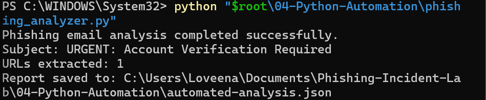
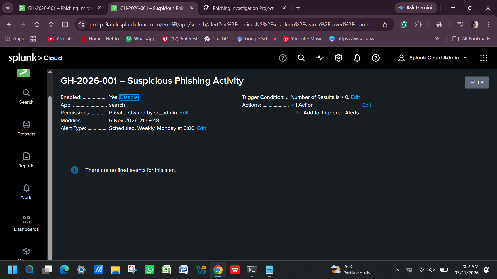
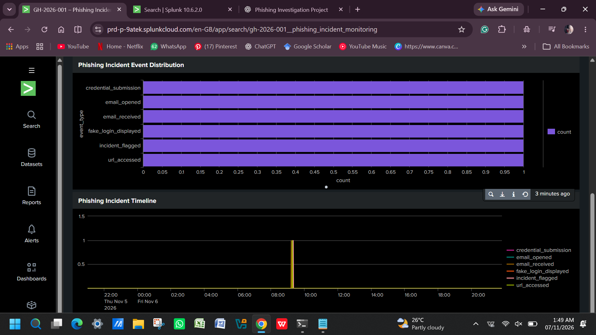

# Phishing Email Investigation and Incident Response

## 1. Project Overview

This project demonstrates an end-to-end phishing email investigation and incident response workflow through a controlled cybersecurity simulation.

The scenario involves a fictional organisation, Gulf Horizon Travel LLC, where an employee receives a suspicious email impersonating Microsoft 365 Support. The email uses urgency and account suspension threats to encourage the employee to verify their account through a fraudulent link.

The investigation explores how phishing emails can be examined, suspicious indicators extracted, threat intelligence researched, analysis automated using Python, and suspicious activity monitored through Splunk.

All incident-related evidence and activity records are synthetic and created for educational purposes.

## 2. Project Objectives

- Investigate a simulated phishing email using email forensic techniques.
- Examine email headers and identify suspicious characteristics.
- Extract Indicators of Compromise (IOCs).
- Research and enrich indicators using external threat intelligence sources.
- Automate email analysis using Python.
- Map relevant activities to the MITRE ATT&CK framework.
- Develop SPL queries for phishing activity detection.
- Create a Splunk monitoring dashboard and configure an alert.
- Document incident response procedures and recommendations.

## 3. Tools and Technologies

- Python
- Splunk Cloud
- Splunk Processing Language (SPL)
- Visual Studio Code
- VirusTotal
- URLScan
- MITRE ATT&CK
- PowerShell
- SHA-256 hashing

## 4. Investigation Workflow

### Phase 1 – Phishing Email Analysis

Created a synthetic phishing email impersonating Microsoft 365 Support.

Investigated:
- Sender address and domain.
- Reply-To and Return-Path mismatches.
- Email subject and social engineering techniques.
- SPF, DKIM and DMARC authentication results.
- Suspicious hyperlink and HTML content.

### Phase 2 – IOC Extraction

Extracted the following synthetic indicators:

- Suspicious URL: https://login-microsoft365-secure.example/verify
- Sender IP: 192.0.2.44
- Sender domain: support-microsoft365.example

These indicators were documented for further investigation.

### Phase 3 – Threat Intelligence Research

Used external threat intelligence resources to examine phishing techniques targeting Microsoft 365 users.

Research included:
- VirusTotal indicator analysis.
- URLScan observations.
- Comparison with publicly reported Microsoft 365 phishing campaigns.
- Examination of credential theft and adversary-in-the-middle phishing techniques.

External research was used for contextual understanding and does not establish attribution to the simulated incident.

### Phase 4 – Python Automation

Developed a Python script to automate the analysis of the synthetic phishing email. 

The script:
- Parses email headers.
- Extracts sender, recipient and subject information.
- Identifies URLs and domains.
- Generates a structured JSON analysis report.

The script uses Python standard libraries, including email, re, json, pathlib and urllib.parse.

### Phase 5 – MITRE ATT&CK Mapping

Mapped relevant phishing activities to the MITRE ATT&CK framework.

- T1566.002 – Spearphishing Link.
- T1204.001 – Malicious Link.

The mapping distinguishes the phishing link observed in the synthetic email from the separately simulated user interaction.

### Phase 6 – SIEM Detection Using Splunk

Imported a synthetic web activity CSV dataset into Splunk Cloud to demonstrate phishing-related event monitoring.  

Developed SPL queries to:

- Identify suspicious URL access events.
- Detect simulated credential submission events.
- Review the incident activity sequence.
- Summarise events by activity type and result.

Configured a scheduled Splunk alert titled:

GH-2026-001 – Suspicious Phishing Activity

The alert was configured with a high severity and a trigger condition based on matching suspicious activity events.

### Phase 7 – Security Monitoring Dashboard

Created a Splunk dashboard titled:

GH-2026-001 – Phishing Incident Monitoring 

The dashboard contains five panels:

1. Total Phishing Incident Events.
2. Suspicious URL Accesses.
3. Credential Exposure Events.
4. Phishing Incident Event Distribution.
5. Phishing Incident Timeline.

Also configured a scheduled Splunk alert to demonstrate alert creation and trigger conditions.

### Phase 8 – Incident Response

Developed an incident response plan covering:

- Containment.
- Eradication.
- Recovery.
- Lessons learned.
- Evidence preservation.

Documented recommended actions for securing a potentially exposed employee account, including password reset, session revocation, multi-factor authentication and monitoring for suspicious sign-ins.

Created a simulated incident timeline and an evidence register to support investigation documentation.

## 5. Project Structure

Phishing-Incident-Lab/
│
├── 01-Email-Samples/
│   └── phishing-sample.eml
│
├── 02-Email-Forensics/
│   ├── initial-findings.txt
│   ├── header-analysis.txt
│   └── html-analysis.txt
│
├── 03-Threat-Intelligence/
│   ├── iocs.txt
│   ├── external-intelligence.txt
│   └── campaign-comparison.txt
│
├── 04-Python-Automation/
│   ├── phishing_analyzer.py
│   ├── automated-analysis.json
│   └── README.txt
│
├── 05-Splunk-Detection/
│
├── 06-MITRE-ATTACK/
│   └── technique-mapping.txt
│
├── 07-Incident-Response/
│   ├── interaction-simulation.txt
│   ├── incident-response-plan.txt
│   └── incident-timeline.txt
│
├── 08-Evidence/
│   ├── file-integrity.txt
│   ├── simulated-web-activity.csv
│   ├── evidence-register.txt
│   └── phishing-incident-dashboard-complete.png
│
├── 09-Final-Report/
│   └── GH-2026-001-Incident-Report.txt
│
└── README.md

## 6. Skills Demonstrated

Security Operations:
- Phishing Investigation.
- Email Forensics.
- SIEM Monitoring.
- SPL Query Development.
- Security Event Analysis.
- Threat Intelligence.
- IOC Extraction and Enrichment.
- MITRE ATT&CK Mapping.

Technical Skills:
- Python Scripting.
- PowerShell.
- JSON Analysis.
- Log Analysis.
- SHA-256 File Integrity Verification.

Incident Response:
- Incident Classification.
- Evidence Documentation.
- Containment Planning.
- Eradication and Recovery Planning.

## 7. Key Learning Outcomes

Through this project, I developed practical experience in connecting multiple cybersecurity investigation stages into a single incident workflow.

The project strengthened my understanding of how email forensics, threat intelligence, automation and SIEM monitoring can support phishing investigations and incident response.

It also highlighted the importance of evidence integrity, analytical accuracy and distinguishing confirmed findings from assumptions.

## 8. Limitations and Disclaimer

This project is a controlled cybersecurity portfolio simulation.

- Email samples, internal activity records, domains and IP addresses used in the scenario are synthetic.
- No real credentials were collected or transmitted.
- No malicious URL was visited.
- No actual organisation, employee account or corporate endpoint was compromised.
- External threat intelligence is contextual research and does not establish attribution.
- Splunk detection was demonstrated using a static CSV dataset, not a live production telemetry feed.
- The scheduled alert was configured, but an actual alert notification was not demonstrated.
- All findings should be interpreted within the scope of this simulation.

## Author

Loveena Biju
www.linkedin.com/in/loveena-biju 

Areas of Interest:
- Security Operations Centre (SOC).
- Threat Intelligence.
- Incident Response.
- Vulnerability Assessment and Security Analysis.

